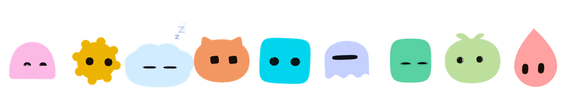
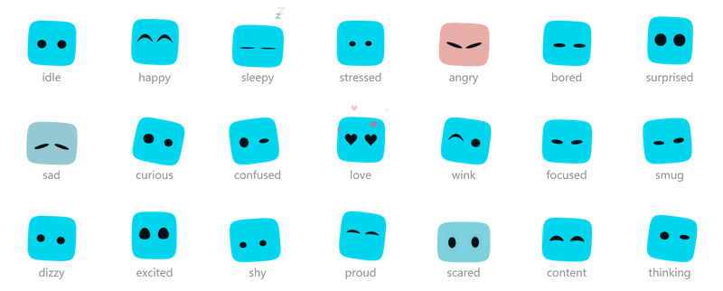
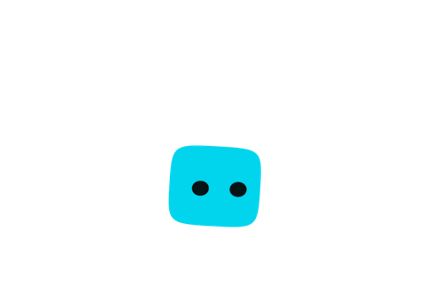
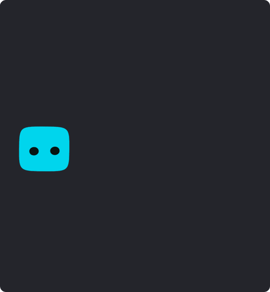

<p align="center">
  <picture>
    <source media="(prefers-color-scheme: dark)" srcset="docs/dark/buddies.gif">
    
  </picture>
</p>

<h1 align="center">DesktopBuddy</h1>

<p align="center">
  <strong>A tiny creature that lives on your desktop.</strong><br>
  It watches your cursor, gets sleepy, gets grumpy, and looks like no one else's.
</p>

<p align="center">
  
  <a href="https://github.com/jaineeldev/desktop_buddy/releases/latest"></a>
  <a href="https://jaineel.dev/desktopbuddy"></a>
  
  
  <a href="LICENSE"></a>
</p>

---

## Meet your buddy

Give it a name and it grows a face. The name decides everything: its shape, its colour, its eyes, even the rhythm it breathes to. The same name always makes the same buddy, and a different name makes a completely different one, so yours is yours.

Then it just lives there. It sits on top of your windows, keeps an eye on your cursor wherever it goes, and has opinions about its day. Maybe one day it'll even answer back when you type to it.

<p align="center">
  <picture>
    <source media="(prefers-color-scheme: dark)" srcset="docs/dark/moods.gif">
    
  </picture>
</p>

## What it can do

**One of a kind.** Ten body shapes, five eye styles and a full colour wheel, mixed by name, plus six hand-drawn extras to choose from. Like one part but not the rest? Pin just that part and let the name decide everything else.

**Alive, not looping.** It breathes, bobs, sways, blinks and glances around on its own timing, with the odd double blink, so two buddies side by side rarely move in step.

**Always watching.** Its eyes follow your cursor anywhere on the screen, up and down as well as side to side, and its body leans in a beat later, like it's turning to look. Leave the mouse alone and it starts looking around by itself.

**Moods you can read.** Fifteen of them, from happy, sad and sleepy to curious, confused, smug and dizzy, each with its own face and body language. An angry buddy flushes red and trembles, a sad one loses its colour, and one in love gets heart eyes as little hearts float up around it.

**It reacts to you.**

<p align="center">
  <picture>
    <source media="(prefers-color-scheme: dark)" srcset="docs/dark/reactions.gif">
    
  </picture>
</p>

- **Pet it.** It squishes under your cursor and springs back, happy, and now and then it winks. Double-click and it jumps. Keep petting and it falls in love. Stroke your cursor back and forth over it for a belly rub and it melts flat.
- **Pick it up.** It looks surprised, swings along behind your cursor and squashes as it lands, right where you put it. Shake it and it gets dizzy. Whip your cursor around fast and it gets dizzy just watching.
- **It notices your day.** It perks up when your cursor arrives, gets bored after 2 minutes alone and dozes off after 5, with little z's floating up. Typing counts as being around. It says hello for the time of day, welcome back after a break, and might suggest bed after midnight. On a laptop it feels the battery: drained when it's low, perky when you plug in.
- **It talks.** Every so often it says something in a speech bubble: a comment when you click it, a word about a good belly rub, a complaint when you've made it dizzy. It never says the same thing twice in a row, remembers little milestones like your 100th pet and a week together, and there are a few secret names to find. Prefer it quiet? Turn on quiet mode.

**Always on top, never in the way.** It stays above your other windows, full-screen videos and most games included, and follows you to every virtual desktop. (A game in exclusive full-screen mode draws over everything, so set it to borderless or windowed to keep your buddy in view.) Only the buddy itself catches your mouse. The space around it lets clicks straight through to whatever is underneath. Press **Ctrl+Alt+B** to hide it or bring it back, handy when you're sharing your screen.

**Stays where you put it.** It remembers where you left it between launches, and hops back onto a screen if the one it was on disappears. Push it past the edge of your screen and it tucks in halfway, leaning out to peek at you. It only does that when you drag it there; it never moves on its own.

<p align="center">
  <picture>
    <source media="(prefers-color-scheme: dark)" srcset="docs/dark/peek.gif">
    
  </picture>
</p>

**A warm welcome.** The first time you open DesktopBuddy, your new buddy introduces itself in speech bubbles. You name it (its face changes as you type), then try petting it, carrying it and giving it a new look. You can skip it, or replay it any time from the tray.

**Lives in your tray.** The tray icon is your own buddy, and it changes whenever your buddy does.

**Keeps itself up to date.** New versions download in the background, with a little progress ring floating over your buddy's head, and it tells you in a speech bubble when one is ready. Restart it there and then, or it updates the next time it closes. Either way, it pops back up on the new version, tells you so, and can show you what's new. Want to check right now? Press **Check for updates** at the bottom of the panel.

## Make it yours

<p align="center">
  <picture>
    <source media="(prefers-color-scheme: dark)" srcset="docs/dark/customise.gif">
    
  </picture>
</p>

Right-click your buddy to open its panel:

- Rename it (its face changes as you type), or roll a random name.
- Pick a body shape, including six hand-drawn extras: mochi, bean, ghost, kitty, sprout and slime.
- Choose its eyes (dots, domes, squares, capsules or visor) and fine-tune them: size, width, spacing, squareness, tilt, height and how far left or right they sit.
- Set its colour and tone, its size and its opacity.
- Turn cursor-following, always-on-top, start with Windows and quiet mode on or off. Quiet mode stops the chatter, but your buddy still tells you about updates.
- Check for updates, hide it or quit it, from the buttons at the bottom.

Everything saves automatically, and your buddy is waiting just as you left it next time.

## Download

DesktopBuddy is free, for **Windows 10 and 11**.

1. Download it from [jaineel.dev/desktopbuddy](https://jaineel.dev/desktopbuddy), or grab the `DesktopBuddy-Windows-…-Setup.exe` file from the [latest release](https://github.com/jaineeldev/desktop_buddy/releases/latest).
2. Run it. The installer isn't code-signed yet, so Windows SmartScreen may show "Windows protected your PC". Click **More info**, then **Run anyway**.
3. Your new buddy wakes up and introduces itself.

To close it, right-click your buddy and press **Quit DesktopBuddy** at the bottom of the panel, or right-click the tray icon and choose **Quit**.

Want it there every time you log in? Right-click your buddy and turn on **start with Windows**, or tick **Start with Windows** in the tray menu.

You only need to install it once. After that it keeps itself up to date, and your buddy tells you when a new version is ready. The one exception: if you installed the very first version (v0.1.0), download the newest one by hand once, because that version can't update itself.

**What it can and can't access.** DesktopBuddy needs no admin rights and asks for no special permissions.

- It reads where your mouse pointer is, so its eyes can follow it.
- It checks how long it's been since you last used your keyboard or mouse, so it knows when you're away. It never sees what you type.
- On a laptop, it reads the battery level and whether it's charging.
- It saves your buddy's name, settings and the milestones it remembers on your PC.
- It connects to GitHub, and nothing else, to check for new versions. It doesn't collect or send any data about you.
- It starts with Windows only if you turn that option on.
- It doesn't use your camera, microphone, location, clipboard or files.

The SmartScreen warning is there because the installer isn't code-signed yet, not because of anything the app does.

Found a bug or have an idea? [Open an issue](https://github.com/jaineeldev/desktop_buddy/issues). Your feedback shapes what comes next.

## Coming soon

- **Notices what you're up to.** It bops along to your music and watches videos with you, with an option to step aside during full-screen videos and games.
- **Knows your PC.** It reacts to your CPU and memory: stressed when your machine is working hard, sleepy when it's quiet. A small panel beside it shows CPU, RAM and the time.
- **Personality.** More to say for every mood.

Windows comes first. Linux and macOS may follow later.

## Maybe one day

These are ideas being explored, not promises. They aren't built yet, and they may change or never happen.

- **Chat with your buddy.** Type a message and your buddy replies in a speech bubble, in character, with a thinking face while it waits. It would run on an AI of your choice (Claude, GPT, Gemini, or a local model through Ollama) using your own API key, kept encrypted on your machine.
- **Talk out loud.** If chatting works out, speaking to your buddy could follow.

## Made with AI help

To be clear about how this app is made: AI has been used to help build DesktopBuddy from the start, and it still is. AI coding assistants, including Claude, help design the buddy, write small parts of code and assist in drafting such as docs this one. I am the only person in direct control of the project and decide what gets built then build it and  ship it.

## License

The code is open source under the [MIT License](LICENSE): you're free to learn from it, change it and use it in your own projects, as long as you keep the copyright notice. The DesktopBuddy name and Sora, its mascot, aren't part of that, so please don't use them for your own apps.

---

## 🛠️ Under the Hood

Everything below is for developers and anyone curious about how DesktopBuddy is built. It's a hybrid stack: a modern web frontend for the buddy and its UI, and (planned) a C backend for low-level system access.

### How the faces work

There are no images or sprite sheets. Every buddy is drawn from scratch, in code:

1. The name is hashed, and each trait (shape, size, eye spacing, colour, blink rate and more) gets its own value from it.
2. Bodies are built from superellipses, smooth splines and overlapping circles.
3. Colours are picked in OKLCH, so every hue looks equally vivid, and the eyes always keep strong contrast against the body.
4. Moods reshape the eyes and shift the body's posture, so every face style can show every mood.

### 🚀 Getting Started

You'll need Windows and Node.js 18 or later.

```bash
npm install
npm run dev
```

Right-click the buddy to customise it. To browse lots of faces at once, open `http://localhost:5173/?gallery` while the dev server is running.

To build the Windows installer:

```bash
npm run build
```

It ends up in `release/<version>/` as `DesktopBuddy-Windows-<version>-Setup.exe`, next to a `.blockmap` and `latest.yml`. Upload all three to a GitHub release: the installed app reads `latest.yml` to find new versions, and the blockmap lets it download only what changed.

If the build stops with "Cannot create symbolic link", turn on Windows Developer Mode and run it again. One of electron-builder's downloads contains macOS links that Windows only lets you create in that mode.

### 🧱 Tech Stack

| Layer | Technology | Purpose |
|---|---|---|
| UI & Mascot | React + TypeScript | The buddy and the customise panel |
| Animation | Framer Motion + CSS | Mood changes, eye movement, breathing and blinking |
| Desktop Shell | Electron + Vite | Transparent always-on-top window, click-through, tray |
| State | Zustand | Moods, plus settings saved between restarts |
| System Stats | C (native Node addon via `node-addon-api`) *(planned)* | CPU, RAM via Windows API |
| Packaging | electron-builder | Windows installer |
| Updates | electron-updater | New versions from GitHub Releases, installed on restart |
| AI Chat | Claude, GPT, Gemini, Ollama *(possible future)* | Typing to your buddy with your own API key |

### 📂 Project Structure

```
desktop_buddy/
├── build/                   # App icon for the installer
├── electron/
│   ├── main.ts              # Window creation, one-buddy-at-a-time lock
│   ├── preload.ts           # Secure contextBridge IPC
│   ├── tray.ts              # Tray menu, with your buddy as the tray icon
│   ├── cursor.ts            # Feeds the cursor position so the eyes can follow it
│   ├── interaction.ts       # Click-through, dragging, carry speed, shake detection, always-on-top
│   ├── windowState.ts       # Remembers where the buddy was left, and keeps it on a screen
│   ├── peek.ts              # Tucks the buddy in when it's dragged past a screen edge
│   ├── activity.ts          # Time since any keyboard or mouse input, for boredom and sleep
│   ├── updater.ts           # Checks GitHub Releases, downloads updates, installs on restart
│   └── stats-bridge.ts      # (planned) Calls the C addon, exposes via IPC
├── src/
│   ├── components/
│   │   ├── Buddy/           # Face generator, moods, animation
│   │   ├── Chatter/         # The buddy's passing comments, and the lines it picks from
│   │   ├── Onboarding/      # The first-run intro
│   │   ├── SettingsPanel/   # Right-click customise panel
│   │   ├── SpeechBubble/    # What the buddy says, and where the bubble goes
│   │   ├── UpdateBubble/    # The buddy's news when an update is ready
│   │   ├── WhatsNew/        # The what's new card shown after an update
│   │   └── StatHUD/         # (planned)
│   ├── hooks/               # Gaze, mouse handling, reactions, tray icon, (planned) system stats
│   ├── stores/              # Buddy state and saved settings
│   ├── dev/Gallery.tsx      # Face browser, opened with ?gallery
│   ├── whatsNew.ts          # Release notes, in the buddy's voice
│   └── App.tsx
├── native/                  # (planned) stats.c, stats.h, binding.gyp
└── docs/                    # README artwork
```

### 🗺️ Roadmap

DesktopBuddy is built in public, one phase at a time. Ticked items have shipped; the rest is roughly in the order it'll happen.

#### ✅ Shipped — v0.1 and v0.2
> A buddy that lives on your desktop, looks like no one else's, and keeps itself up to date.

**The buddy**

- [x] Faces generated from the buddy's name: ten body shapes, five eye styles and a full colour wheel, plus six hand-drawn extras
- [x] Fifteen moods that morph smoothly into each other, including heart eyes and floating hearts for `love`
- [x] Idle life: breathes, bobs, sways, blinks and glances around on its own timing
- [x] Eyes that follow your cursor anywhere on screen, with a body that leans in to look
- [x] Physics: squishes when pressed, wobbles when let go, swings when carried and squashes when dropped
- [x] Reactions: petting, double-clicks, falling in love, grab, drop and shake, hover, boredom and sleep, new looks, waking up
- [x] Customise panel: name, shape, eyes (with fine-tuning), colour, size, opacity and behaviour

**The app**

- [x] Transparent, always-on-top window where only the buddy catches clicks
- [x] Tray menu, with your own buddy as the tray icon
- [x] First-run intro in speech bubbles
- [x] Windows installer, published on GitHub, with a Start with Windows option
- [x] Automatic updates from GitHub Releases, with a download ring and a what's new card
- [x] A smaller install, and idle breathing that runs on the GPU

#### ✅ Shipped — v0.3 and v1.0, feels at home
> Quick fixes and little touches that make it nicer to live with.

- [x] Remember where you put it between launches, and bring it back on screen if a monitor is unplugged
- [x] Count typing as activity, so it doesn't doze off while you write without touching the mouse
- [x] A keyboard shortcut to hide and show it (Ctrl+Alt+B), for screen-sharing and presenting
- [x] Floating "z"s when it's asleep
- [x] Edge peeking: push it past the screen edge and it tucks in halfway, peeking out
- [x] Belly rubs: stroke your cursor back and forth over it and it melts with happy eyes
- [x] Gets dizzy just watching you whip the cursor around
- [x] Click it and now and then it says something in a speech bubble

#### ✅ Shipped — v1.0.1, fixes from your feedback
> Thanks to everyone who reported these.

- [x] Always on top for real: it climbs back above games, video players and other always-on-top windows, survives Show desktop, and follows you to every virtual desktop
- [x] Quit, hide and check for updates right from the panel, no hunting for the tray icon
- [x] Start with Windows and a quiet mode in the panel
- [x] The panel keeps clear of anything your buddy is saying, and speech bubbles are centred

#### Next up — Notices what you're up to
> It reacts to what's happening on your screen, without ever listening to your audio or reading your keys or files.

- [ ] Bops along with floating music notes while music plays, using Windows' media info
- [ ] Watches videos with you, with an option to step aside during full-screen videos and games
- [x] Battery moods on laptops: drained when it's low, perky when it's plugged in
- [x] Time-of-day greetings (morning, afternoon, evening, late night), and welcome back after a break
- [ ] A pool of things to say for each mood, so it never sounds like a recording

#### Then — Knows your PC
> Real C that reads system stats through the Windows API, and a buddy that reacts to them.

- [ ] Set up `node-addon-api` in the project
- [ ] Write `stats.c`: CPU usage via `GetSystemTimes` and RAM via `GlobalMemoryStatusEx`
- [ ] Compile it to a `.node` native addon, called from `stats-bridge.ts` over IPC
- [ ] A `useSystemStats` hook that polls every 2 seconds
- [ ] `StatHUD`: a small panel beside the buddy with CPU, RAM and the time
- [ ] Reacts to stats: stressed when your CPU is busy, sleepy when things are quiet
- [ ] Comments on what your computer is up to
- [ ] Stat toggles in the customise panel

#### Later — Little helpers and sharing
> Ways it can help out, and ways to show it off.

- [ ] Focus timer from the tray: a focused face while you work, and a celebration at break time
- [ ] Gentle reminders, off by default: drink water, stretch, it's late so go to bed
- [ ] Buddy codes: share your buddy (name and pinned look) as a short code a friend can paste in
- [x] Secret names that unlock a reaction of their own, and a sparkle
- [x] Little milestones it remembers and mentions once: pets, belly rubs, anniversaries
- [ ] A friend for your buddy: two buddies that notice and react to each other
- [x] A landing page with the GIFs and a download button, at [jaineel.dev/desktopbuddy](https://jaineel.dev/desktopbuddy)
- [ ] Free code signing (for example through SignPath Foundation) to drop the SmartScreen warning, once the project qualifies

#### Possible Future — AI Chat
> Being explored, not committed. Not started, and the details may change.

- [ ] Type to your buddy and get replies in a speech bubble, in character
- [ ] A "thinking" face while it waits, and moods that react to the conversation
- [ ] Choose Claude, GPT, Gemini or a local model through Ollama, with your own API key
- [ ] Keep API keys encrypted on your machine (Electron `safeStorage`), never exposed to the UI
- [ ] Later: talking out loud, and tools like timers and reminders

#### Stretch Goal — Cross-Platform
> Not planned, but possible later.

- [ ] Abstract stats module for Linux (`/proc/stat`, `/proc/meminfo`)
- [ ] Handle `#ifdef _WIN32` / `#ifdef __linux__` in C code
- [ ] Test tray behaviour on Linux and macOS
- [ ] Package for Linux and macOS targets

### 📖 Resources

- **C fundamentals:** [Bro Code — C Full Course (YouTube)](https://www.youtube.com/watch?v=xND0t1pr3KY)
- **C reference:** [Beej's Guide to C Programming](https://beej.us/guide/bgc/)
- **Electron:** [Electron Quick Start](https://www.electronjs.org/docs/latest/tutorial/quick-start)
- **Framer Motion:** [motion.dev/docs](https://motion.dev/docs)
- **Zustand:** [github.com/pmndrs/zustand](https://github.com/pmndrs/zustand)
- **Native addons:** [Node.js Addons Guide](https://nodejs.org/api/addons.html)

### 🙏 Thanks

The flat, geometric face style was inspired by [blobatar](https://blobatar.dev) by Alain.

*Built by Jaineel with AI assistance — learning in public, one phase at a time.*
